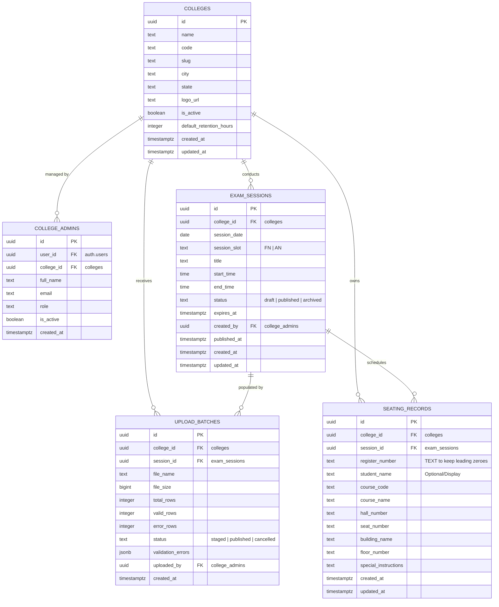

# HallPilot — Database Design & Schema Specification

> **Platform:** Supabase (PostgreSQL 15+)  
> **Architecture:** Multi-Tenant via Row-Level Security (RLS) & Isolation Policies

---

## 1. Entity-Relationship Diagram (ERD)



---

## 2. Table Schemas & Data Types

### 2.1 `colleges`
Stores verified educational institutions onboarded onto HallPilot.

| Column | Type | Constraints | Description |
|---|---|---|---|
| `id` | `uuid` | `PRIMARY KEY DEFAULT gen_random_uuid()` | Unique college identifier |
| `name` | `text` | `NOT NULL` | Full legal college name (e.g. *Apex Institute of Technology*) |
| `code` | `text` | `NOT NULL UNIQUE` | Short institutional code (e.g. `AIT`, `KCT`, `REC`) |
| `slug` | `text` | `NOT NULL UNIQUE` | URL-safe slug for search routes (e.g. `apex-institute`) |
| `city` | `text` | `NULLABLE` | City location for quick discovery filter |
| `state` | `text` | `NULLABLE` | State / Region |
| `logo_url` | `text` | `NULLABLE` | Public storage URL for institutional emblem |
| `is_active` | `boolean` | `NOT NULL DEFAULT true` | Master platform killswitch for institution |
| `default_retention_hours` | `integer` | `NOT NULL DEFAULT 24` | Auto-expiry threshold post session end time |
| `created_at` | `timestamptz` | `NOT NULL DEFAULT now()` | Row creation timestamp |
| `updated_at` | `timestamptz` | `NOT NULL DEFAULT now()` | Last update timestamp |

### 2.2 `college_admins`
Maps Supabase `auth.users` to a specific tenant `college_id`.

| Column | Type | Constraints | Description |
|---|---|---|---|
| `id` | `uuid` | `PRIMARY KEY DEFAULT gen_random_uuid()` | Admin record identifier |
| `user_id` | `uuid` | `NOT NULL UNIQUE REFERENCES auth.users(id) ON DELETE CASCADE` | Linked Supabase auth account |
| `college_id` | `uuid` | `NOT NULL REFERENCES colleges(id) ON DELETE CASCADE` | Tenant scope |
| `full_name` | `text` | `NOT NULL` | Admin official name |
| `email` | `text` | `NOT NULL` | Official institutional email |
| `role` | `text` | `NOT NULL DEFAULT 'admin' CHECK (role IN ('super_admin', 'admin', 'viewer'))` | RBAC role |
| `is_active` | `boolean` | `NOT NULL DEFAULT true` | Admin status flag |
| `created_at` | `timestamptz` | `NOT NULL DEFAULT now()` | Creation timestamp |

### 2.3 `exam_sessions`
Represents an individual examination slot (e.g., Nov 14, 2026 Forenoon).

| Column | Type | Constraints | Description |
|---|---|---|---|
| `id` | `uuid` | `PRIMARY KEY DEFAULT gen_random_uuid()` | Unique session identifier |
| `college_id` | `uuid` | `NOT NULL REFERENCES colleges(id) ON DELETE CASCADE` | Associated college |
| `session_date` | `date` | `NOT NULL` | Calendar date of examination |
| `session_slot` | `text` | `NOT NULL CHECK (session_slot IN ('FN', 'AN'))` | Forenoon or Afternoon slot |
| `title` | `text` | `NOT NULL` | Descriptive name (e.g. *Semester V Theory Examinations*) |
| `start_time` | `time` | `NOT NULL` | e.g. `09:30:00` |
| `end_time` | `time` | `NOT NULL` | e.g. `12:30:00` |
| `status` | `text` | `NOT NULL DEFAULT 'draft' CHECK (status IN ('draft', 'published', 'archived'))` | Publishing workflow state |
| `expires_at` | `timestamptz` | `NOT NULL` | Calculated timestamp after which lookups cease |
| `created_by` | `uuid` | `REFERENCES college_admins(id) ON DELETE SET NULL` | Audit: creator |
| `published_at` | `timestamptz` | `NULLABLE` | Timestamp when status transitioned to `published` |
| `created_at` | `timestamptz` | `NOT NULL DEFAULT now()` | Record created |
| `updated_at` | `timestamptz` | `NOT NULL DEFAULT now()` | Record updated |

**Unique Constraint:** `UNIQUE (college_id, session_date, session_slot, title)` to prevent accidental duplicate sessions.

### 2.4 `seating_records`
The high-volume core table containing seating placements.

| Column | Type | Constraints | Description |
|---|---|---|---|
| `id` | `uuid` | `PRIMARY KEY DEFAULT gen_random_uuid()` | Unique seating row |
| `college_id` | `uuid` | `NOT NULL REFERENCES colleges(id) ON DELETE CASCADE` | Multi-tenant partition |
| `session_id` | `uuid` | `NOT NULL REFERENCES exam_sessions(id) ON DELETE CASCADE` | Parent exam session |
| `register_number` | `text` | `NOT NULL` | **String type to strictly preserve leading zeros** (e.g., `00421`, `09CS102`) |
| `student_name` | `text` | `NULLABLE` | Display name / initials for confirmation |
| `course_code` | `text` | `NULLABLE` | Course or Subject ID (e.g. `CS8501`) |
| `course_name` | `text` | `NULLABLE` | Full course title (e.g. `Distributed Systems`) |
| `hall_number` | `text` | `NOT NULL` | Examination Hall / Room (e.g. `LH-204`, `AUD-1`) |
| `seat_number` | `text` | `NULLABLE` | Seat / Desk coordinate (e.g. `B-12`, `R3-S4`) |
| `building_name` | `text` | `NULLABLE` | Campus building or block (e.g. `Academic Block C`) |
| `floor_number` | `text` | `NULLABLE` | Floor level (e.g. `2nd Floor`) |
| `special_instructions` | `text` | `NULLABLE` | Any custom remarks (e.g. *Calculator Allowed*) |
| `created_at` | `timestamptz` | `NOT NULL DEFAULT now()` | Insertion timestamp |
| `updated_at` | `timestamptz` | `NOT NULL DEFAULT now()` | Update timestamp |

**Unique Constraint:** `UNIQUE (session_id, register_number)` — guarantees a student cannot be allocated to two distinct halls in the exact same exam session.

### 2.5 `upload_batches`
Audit logging table for file uploads, tracking ingestion stats and staging metadata.

| Column | Type | Constraints | Description |
|---|---|---|---|
| `id` | `uuid` | `PRIMARY KEY DEFAULT gen_random_uuid()` | Batch identifier |
| `college_id` | `uuid` | `NOT NULL REFERENCES colleges(id) ON DELETE CASCADE` | Tenant |
| `session_id` | `uuid` | `NOT NULL REFERENCES exam_sessions(id) ON DELETE CASCADE` | Associated session |
| `file_name` | `text` | `NOT NULL` | Original uploaded filename |
| `file_size` | `bigint` | `NOT NULL` | Byte size |
| `total_rows` | `integer` | `NOT NULL DEFAULT 0` | Total records in sheet |
| `valid_rows` | `integer` | `NOT NULL DEFAULT 0` | Validated row count |
| `error_rows` | `integer` | `NOT NULL DEFAULT 0` | Invalid / rejected row count |
| `status` | `text` | `NOT NULL DEFAULT 'staged' CHECK (status IN ('staged', 'published', 'cancelled'))` | Processing status |
| `validation_errors`| `jsonb` | `DEFAULT '[]'::jsonb` | Structured array of validation errors |
| `uploaded_by` | `uuid` | `REFERENCES college_admins(id) ON DELETE SET NULL` | Admin who performed upload |
| `created_at` | `timestamptz` | `NOT NULL DEFAULT now()` | Upload timestamp |

---

## 3. High-Performance Indexing Strategy

1. **Student Fast-Lookup Index:**
   ```sql
   CREATE INDEX idx_seating_lookup 
   ON seating_records (college_id, register_number, session_id);
   ```
   *Rationale:* Facilitates sub-10ms B-tree lookups when student searches `(college_id, register_number)`.

2. **Session Lifecycle & Expiry Index:**
   ```sql
   CREATE INDEX idx_sessions_active 
   ON exam_sessions (college_id, status, expires_at);
   ```
   *Rationale:* Quick evaluation of whether a session is `published` and `expires_at > now()`.

3. **Admin RLS Tenant Index:**
   ```sql
   CREATE INDEX idx_college_admins_lookup 
   ON college_admins (user_id, college_id);
   ```
   *Rationale:* Instantly resolves current admin's `college_id` inside Supabase RLS security policies.

---

## 4. Anti-Scraping Database RPC (Remote Procedure Call)

To satisfy the critical security requirement:
> *"Do not expose the full student register list through public endpoints."*

The `seating_records` table will **NEVER have `SELECT` granted to the `anon` (public) role**. Direct queries like `supabase.from('seating_records').select('*')` will be blocked with a `403 Forbidden` for public users.

Public lookups will be strictly channeled through a secure Postgres function:

```sql
CREATE OR REPLACE FUNCTION lookup_student_hall(
    p_college_id UUID,
    p_register_number TEXT
)
RETURNS TABLE (
    session_id UUID,
    session_title TEXT,
    session_date DATE,
    session_slot TEXT,
    start_time TIME,
    end_time TIME,
    hall_number TEXT,
    seat_number TEXT,
    building_name TEXT,
    floor_number TEXT,
    course_code TEXT,
    course_name TEXT,
    special_instructions TEXT,
    college_name TEXT
) 
LANGUAGE plpgsql
SECURITY DEFINER -- Runs with elevated rights to query seating_records safely
SET search_path = public
AS $$
BEGIN
    -- 1. Input sanitization: Trim whitespace, enforce non-empty strings
    p_register_number := TRIM(p_register_number);
    
    IF p_register_number IS NULL OR p_register_number = '' OR p_college_id IS NULL THEN
        RETURN;
    END IF;

    -- 2. Query exact matching records for published, active, unexpired sessions ONLY
    RETURN QUERY
    SELECT 
        s.id AS session_id,
        s.title AS session_title,
        s.session_date,
        s.session_slot,
        s.start_time,
        s.end_time,
        r.hall_number,
        r.seat_number,
        r.building_name,
        r.floor_number,
        r.course_code,
        r.course_name,
        r.special_instructions,
        c.name AS college_name
    FROM seating_records r
    INNER JOIN exam_sessions s ON s.id = r.session_id
    INNER JOIN colleges c ON c.id = r.college_id
    WHERE r.college_id = p_college_id
      AND LOWER(r.register_number) = LOWER(p_register_number)
      AND s.status = 'published'
      AND s.expires_at > NOW()
      AND c.is_active = TRUE
    ORDER BY s.session_date ASC, s.start_time ASC;
END;
$$;

-- Grant execution to public anon role
GRANT EXECUTE ON FUNCTION lookup_student_hall(UUID, TEXT) TO anon, authenticated;
```

---

## 5. Automated Data Lifecycle & Expiry

1. **Configurable Retention Window:**
   - Default: `session_date + end_time + 24 hours`.
   - College administrators can customize retention from 2 hours up to 7 days.
2. **Dynamic Query Expiry:**
   - Active queries enforce `s.expires_at > now()`. Expired sessions disappear automatically without needing immediate manual deletion.
3. **Scheduled Archival Worker (pg_cron or Supabase Edge Function):**
   - Batches older than 30 days can have their seating records pruned or moved to compressed cold archive, minimizing storage costs and fulfilling data privacy standards.
