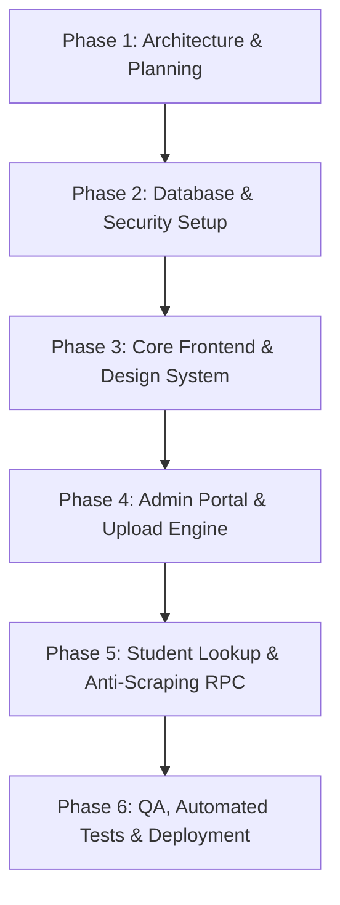

# HallPilot — Project Plan & Architecture

> **Tagline:** "Your Exam Hall, One Search Away."  
> **Platform Vision:** A secure, high-performance, multi-tenant examination hall lookup SaaS that eliminates chaotic paper-based seating notices for colleges and students.

---

## 1. Executive Summary & Scope

HallPilot is designed to digitize and streamline examination seating arrangements across multiple educational institutions. 

### Core Objectives
1. **Zero-Friction Student Access:** Enable students to discover their exam hall, seat number, and session details in under 5 seconds using only their College and Register Number—without creating student accounts or exposing full student rosters publicly.
2. **Robust Multi-Tenant Admin Portal:** Provide authorized college administrators with an intuitive portal to upload Excel/CSV seating rosters, inspect validation summaries, resolve discrepancies in a staging preview, and publish only verified data.
3. **Ironclad Isolation & Privacy:** Ensure strict college-level data isolation using Supabase PostgreSQL Row Level Security (RLS), protect leading zeros in register numbers, enforce automated data expiration, and prevent mass data scraping.

---

## 2. User Roles & Permissions Matrix

| Capability / Resource | Platform Administrator | College Administrator | Student (Public) |
|---|:---:|:---:|:---:|
| **Platform Analytics & Health** | Full Access | No Access | No Access |
| **Manage Colleges Directory** | Create / Verify / Suspend | View own college profile | Select college from public active list |
| **Admin Onboarding & Invites** | Approve / Manage | Self-register (domain verification) | N/A |
| **Manage Exam Sessions** | System overview | Full CRUD (own college only) | View published active sessions |
| **Upload Seating Roster (CSV/XLSX)** | No Access (tenant data) | Upload, preview, publish, delete (own college) | No Access |
| **View Full Seating Roaster** | No Access | Full tabular view (own college) | **Forbidden** (Single lookup only) |
| **Individual Hall Lookup** | Lookup test tool | Admin test lookup | **Exact match lookup** (College + RegNo) |
| **Session Expiry & Archival** | Automated cleanup policies | Set retention / Instant unpublish | Only unexpired published sessions |

---

## 3. Feature Breakdown

### 3.1 Public Landing & Student Lookup Experience
* **Branded Hero & Trust Elements:** Professional edtech visual language with quick navigation and college stats.
* **Streamlined Search Interface:**
  * Step 1: Select College (combobox with search filter).
  * Step 2: Enter Student Register Number (retains exact casing & leading zeros).
  * Step 3: Instant Hall Card Presentation.
* **Information Displayed on Search:**
  * Exam Date & Day
  * Session (`FN` - Forenoon / `AN` - Afternoon) & Timings
  * Course / Subject Code & Title
  * Hall / Room Number & Building / Floor details
  * Seat / Desk Number
  * Important Candidate Instructions (e.g., reporting time, prohibited items)
* **Anti-Scraping & Privacy Safeguards:**
  * Rate-limited queries per IP/fingerprint.
  * Public API returns only single record matching exact Register Number + College ID. Full class lists or wildcards (`*`) are disallowed at database and API levels.

### 3.2 College Admin Authentication & Management
* **Authentication:** Supabase Auth (Email + Password with magic link support and session refresh).
* **College Association:** Each admin profile links strictly to a single `college_id`.
* **College Profile Management:** Configure college name, campus code, logo URL, exam coordinator contact, and default seating retention policy.

### 3.3 Exam Session Management
* Create discrete exam sessions (e.g., `2026-10-15` — `FN Session`).
* Define session start/end times and reporting thresholds.
* Configurable expiry window (e.g., auto-expire 6 hours or 24 hours post-session).

### 3.4 Excel/CSV Upload, Validation & Preview Engine
* **File Ingestion:** Drag-and-drop parsing of `.xlsx`, `.xls`, and `.csv`.
* **Client-Side Sanitization:** Leading-zero preservation for numerical IDs (processed as pure strings).
* **Header Mapping & Normalization:** Intelligent matching of standard column headers (e.g., `Register No`, `Reg_No`, `Hall No`, `Room`).
* **Interactive Staging & Error Preview:**
  * Summary cards: Total Rows, Valid Rows, Duplicate Rows, Missing Fields.
  * Inline error highlighting (e.g., blank register number, invalid session format).
  * Explicit conflict resolution toggle: *Overwrite duplicates* vs. *Skip existing*.
* **Two-Step Publish Workflow:** File parsed $\to$ Staging validated $\to$ Admin reviews preview $\to$ Explicit "Publish to Live" confirmation.

### 3.5 Admin Dashboard & Audit Trail
* Overview metrics: Active published sessions, student lookups handled, recent uploads.
* Seating records management table with quick filtering by session, hall, and department.
* One-click "Unpublish" or "Emergency Revoke" for erroneous session data.

---

## 4. Proposed Frontend Folder Structure

```
HallPilot/
├── public/
│   ├── favicon.svg
│   └── robots.txt
├── docs/
│   ├── PROJECT_PLAN.md
│   ├── DATABASE_DESIGN.md
│   ├── SECURITY_PLAN.md
│   └── UPLOAD_FORMAT.md
├── src/
│   ├── assets/                # Logos, SVG icons, illustrations
│   ├── components/            # Reusable UI component library
│   │   ├── common/            # Buttons, Inputs, Modals, Badges, Loaders
│   │   │   ├── Button.tsx
│   │   │   ├── Input.tsx
│   │   │   ├── Select.tsx
│   │   │   ├── Modal.tsx
│   │   │   ├── Badge.tsx
│   │   │   ├── Alert.tsx
│   │   │   └── Card.tsx
│   │   ├── layout/            # Navigation, Footer, Admin Sidebar, Container
│   │   │   ├── Navbar.tsx
│   │   │   ├── Footer.tsx
│   │   │   ├── AdminLayout.tsx
│   │   │   └── PublicLayout.tsx
│   │   ├── student/           # Student lookup UI components
│   │   │   ├── LookupForm.tsx
│   │   │   ├── HallResultCard.tsx
│   │   │   ├── InstructionsCallout.tsx
│   │   │   └── CollegeSelector.tsx
│   │   └── admin/             # Admin portal components
│   │       ├── FileDropzone.tsx
│   │       ├── UploadPreviewTable.tsx
│   │       ├── ValidationSummary.tsx
│   │       ├── SessionCard.tsx
│   │       ├── CreateSessionModal.tsx
│   │       └── ExpiryConfigModal.tsx
│   ├── context/               # React Context providers (AuthContext, CollegeContext)
│   │   ├── AuthContext.tsx
│   │   └── CollegeContext.tsx
│   ├── hooks/                 # Custom reusable hooks
│   │   ├── useAuth.ts
│   │   ├── useStudentLookup.ts
│   │   ├── useFileUpload.ts
│   │   └── useDebounce.ts
│   ├── lib/                   # External client instances & core utility configs
│   │   ├── supabase.ts        # Supabase client instantiation
│   │   └── constants.ts       # Platform limits, session constants
│   ├── pages/                 # Top-level view routes
│   │   ├── public/
│   │   │   ├── HomePage.tsx            # Hero + Search
│   │   │   ├── LookupPage.tsx          # Dedicated lookup view
│   │   │   ├── AboutPage.tsx           # Institutional overview
│   │   │   └── PrivacyPage.tsx         # Data privacy disclaimer
│   │   └── admin/
│   │       ├── AdminLoginPage.tsx      # Admin sign-in / registration
│   │       ├── AdminDashboardPage.tsx  # Overview & quick stats
│   │       ├── SessionsPage.tsx        # Exam session manager
│   │       ├── UploadSeatingPage.tsx   # Upload & staging preview
│   │       ├── SeatingListPage.tsx     # Searchable published roster
│   │       └── CollegeSettingsPage.tsx # Expiry & college profile
│   ├── services/              # API / Database interaction layer
│   │   ├── authService.ts
│   │   ├── collegeService.ts
│   │   ├── sessionService.ts
│   │   ├── seatingService.ts
│   │   └── lookupService.ts   # Restricted RPC lookup call
│   ├── types/                 # TypeScript interfaces and schema types
│   │   ├── database.types.ts  # Generated Supabase DB types
│   │   ├── models.ts          # Domain models (College, Session, SeatingRecord)
│   │   └── upload.ts          # Parsed rows, validation errors, preview state
│   ├── utils/                 # Pure helper functions
│   │   ├── excelParser.ts     # SheetJS / CSV string-preserving parser
│   │   ├── validators.ts      # Regex & schema checks
│   │   ├── dateUtils.ts       # Formatting for FN/AN, local time
│   │   └── exportUtils.ts     # Template file generator (CSV/Excel)
│   ├── App.tsx                # Main router setup
│   ├── main.tsx               # App entrypoint
│   └── index.css              # Tailwind directives + design system tokens
├── tailwind.config.js
├── tsconfig.json
├── vite.config.ts
└── package.json
```

---

## 5. Phased Implementation Roadmap



* **Phase 1 (Current):** Technical planning, database schema design, security policies, upload specifications, design system definition.
* **Phase 2:** Supabase project setup, SQL migration scripts, tables, constraints, RPC lookup function, RLS policies, sample fictional seed data.
* **Phase 3:** React + Vite + Tailwind scaffolding, design tokens (navy/blue palette), responsive layouts, base UI primitives.
* **Phase 4:** College Admin Auth, Session creation, drag-and-drop Excel/CSV parser, client-side validation engine, staging preview, batch upload & publish.
* **Phase 5:** Public landing page, student single-lookup interface, instant result card, session expiry filtration, rate limiting.
* **Phase 6:** End-to-end testing with fictional sample files, mobile responsiveness verification, GitHub repo setup, Vercel deployment verification.
