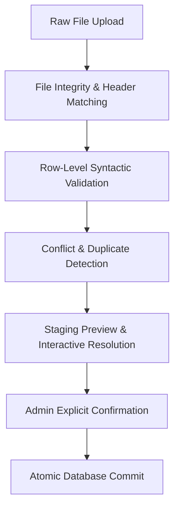

# HallPilot — Upload Format & Validation Specification

> **Supported Formats:** `.xlsx`, `.xls`, `.csv`  
> **Character Encoding:** UTF-8  
> **Primary Rule:** Leading zeros in Register Numbers must be strictly preserved.

---

## 1. Supported Column Schema

HallPilot supports both strict standard column headers and common synonyms (header aliasing) used by college examination cells.

| Canonical Field | Required? | Accepted Header Aliases | Example Value | Validation Rules |
|---|:---:|---|---|---|
| `register_number` | **YES** | `Register No`, `Register Number`, `Reg No`, `Roll No`, `Student ID`, `URN` | `00421`, `23CS014`, `910023` | Non-empty string. 2 to 30 characters. Trimmed, leading zeros preserved. Alphanumeric & hyphens allowed. |
| `hall_number` | **YES** | `Hall`, `Hall No`, `Hall Number`, `Room`, `Room No`, `Exam Hall` | `LH-101`, `Seminar Hall 2`, `B-204` | Non-empty string. 1 to 50 characters. |
| `seat_number` | NO | `Seat`, `Seat No`, `Desk`, `Desk No`, `Bench No` | `S-14`, `Row 2 - Col 3`, `12` | String up to 30 characters. |
| `course_code` | NO | `Subject Code`, `Course Code`, `Paper Code`, `Sub Code` | `CS8501`, `EC302`, `MBA101` | String up to 30 characters. |
| `course_name` | NO | `Subject Name`, `Course Title`, `Subject`, `Paper` | `Database Systems`, `Thermodynamics` | String up to 150 characters. |
| `building_name` | NO | `Building`, `Block`, `Campus Block`, `Wing` | `Tech Block A`, `Main Building` | String up to 100 characters. |
| `floor_number` | NO | `Floor`, `Level`, `Floor No` | `Ground Floor`, `2nd Floor`, `Level 3` | String up to 50 characters. |
| `student_name` | NO | `Name`, `Candidate Name`, `Student Name` | `Alex Johnson` | String up to 100 characters (optional for privacy). |
| `special_instructions` | NO | `Instructions`, `Remarks`, `Notes` | `Scientific Calculator Permitted` | String up to 250 characters. |

---

## 2. Preserving Leading Zeros

A common issue in college examination systems is that spreadsheet tools (like Excel) auto-convert numeric register numbers like `004210` into `4210`, corrupting student search queries.

### HallPilot Implementation Safeguards:
1. **Raw String Extraction:**
   When parsing with `xlsx` (SheetJS) or `PapaParse`:
   ```typescript
   // SheetJS Configuration
   const workbook = XLSX.read(fileData, {
     type: 'binary',
     raw: true, // Forces cell values to be read as raw strings, avoiding numeric conversion
     cellText: true,
   });
   ```
2. **Text Formatter Coercion:**
   For CSV files, values wrapped in quotes (e.g. `="004210"` or `"004210"`) are unescaped cleanly into exact strings without numerical truncation.
3. **Database Column Type:**
   The PostgreSQL column `register_number` is strictly `TEXT`, never `INTEGER` or `BIGINT`.

---

## 3. Validation Pipeline & Error Categories

When an administrator uploads a file, it passes through a 3-tier validation engine before anything is committed to the database:



### 3.1 Header Validation
* **Rule:** At least `register_number` and `hall_number` aliases must be matched.
* **Failure State:** If neither is found, the file is rejected with: *"Missing required headers: Could not identify Register Number and Hall columns. Please use the downloadable template."*

### 3.2 Row Validation Rules
* **Blank Register Number:** Any row where register number is empty or whitespace is flagged as `ERROR_EMPTY_REG_NO`.
* **Blank Hall Number:** Flagged as `ERROR_EMPTY_HALL`.
* **Maximum Length Exceeded:** If any cell exceeds its database column boundary, it is flagged as `ERROR_LENGTH_OVERFLOW`.
* **Malicious Formula Injection:** Cells starting with `=`, `+`, `-`, `@` are sanitized automatically with an alert badge.

### 3.3 Duplicate Detection
1. **Intra-File Duplicates:**
   - Multiple rows in the *same upload file* having the exact same `register_number`.
   - *Behavior:* Flagged with a warning badge showing all line numbers where the conflict occurred.
2. **Database Duplicates (Existing Session Records):**
   - The register number already has an entry in this session in the database.
   - *Resolution Options in Preview:*
     - **Overwrite:** Updates the existing seating assignment.
     - **Skip:** Leaves the existing database record intact and skips the uploaded row.
     - **Cancel:** Aborts upload so admin can fix their master file.

---

## 4. Admin Preview UI State

The upload screen presents a comprehensive summary dashboard prior to publishing:

```
┌────────────────────────────────────────────────────────────────────────┐
│  UPLOAD PREVIEW: 2026-11-14 | FN Session - End Semester Theory        │
├─────────────┬─────────────┬──────────────┬─────────────┬───────────────┤
│ TOTAL ROWS  │ VALID ROWS  │ DUPLICATES   │ ERRORS      │ ACTION NEEDED │
│    1,250    │    1,242    │      6       │      2      │ Review Errors │
├─────────────┴─────────────┴──────────────┴─────────────┴───────────────┤
│ Filter View: [ All Rows ] [ Valid Only ] [ Duplicates (6) ] [ Errors (2) ]
├──────┬──────────────┬──────────────┬──────────┬──────────┬─────────────┤
│ Line │ Register No  │ Hall Number  │ Seat No  │ Course   │ Status      │
├──────┼──────────────┼──────────────┼──────────┼──────────┼─────────────┤
│ 45   │ 004192       │ LH-102       │ B-04     │ CS8401   │ ✓ Valid     │
│ 46   │ [BLANK]      │ LH-102       │ B-05     │ CS8401   │ ⚠ Missing   │
│ 102  │ 004192       │ LH-104       │ C-12     │ CS8401   │ ⚠ Duplicate │
└──────┴──────────────┴──────────────┴──────────┴──────────┴─────────────┘
Duplicate Policy: [ (•) Overwrite existing  ( ) Skip duplicates ]
[ Cancel & Re-upload ]                          [ Confirm & Publish to Live ]
```

---

## 5. Fictional Sample Data Template

Admins will have a 1-click **"Download Sample Template (CSV / XLSX)"** button. 

### Sample CSV Content (`docs/sample_seating_template.csv`):
```csv
Register No,Student Name,Course Code,Course Name,Hall No,Seat No,Building,Floor,Special Instructions
004101,Sample Candidate A,CS8501,Database Management,LH-101,A-01,Science Block,1st Floor,Calculator allowed
004102,Sample Candidate B,CS8501,Database Management,LH-101,A-02,Science Block,1st Floor,Calculator allowed
004103,Sample Candidate C,CS8501,Database Management,LH-101,A-03,Science Block,1st Floor,Calculator allowed
004104,Sample Candidate D,EC3402,Signals and Systems,AUD-01,S-15,Auditorium,Ground Floor,No electronic devices
004105,Sample Candidate E,EC3402,Signals and Systems,AUD-01,S-16,Auditorium,Ground Floor,No electronic devices
```

> **Strict Privacy Guarantee:** Only synthetic dummy data (e.g. `Sample Candidate A`, `004101`) will ever be included in templates or sample fixtures. Real institutional records must never be committed to source repositories.
